# 📊 Dashboard Administrativo - PediuPatrão

> Documentação da atividade prática **Dashboard Administrativo**: análise dos requisitos, modelo de dados, API, evidências de testes e decisões de análise e projeto.

---

<div align="center">


</div>

---

Projeto desenvolvido para a disciplina de **Análise e Projeto de Software** da Universidade de Mogi das Cruzes (UMC).

| |                                   |
|---|-----------------------------------|
| 👩‍🎓 **Autora** | Isabela Tamie Shihara             |
| 🪪 **RGM** | 11231203887                       |
| 🏫 **Turma** | 8ºB - Engenharia de Software      |
| 🌿 **Branch** | `feature/dashboard-api` |
| 🖥️ **Tela** | `http://localhost:8080/dashboard` |
| 🔌 **API** | `http://localhost:8080/api/dashboard/**` |
| 🎬 **Vídeo (até 3 min)** | 🔗 **[Assistir no YouTube](COLE_AQUI_O_LINK_DO_VIDEO_DO_DASHBOARD)** |

<!-- ⚠️ TROCAR "COLE_AQUI_O_LINK_DO_VIDEO_DO_DASHBOARD" PELO LINK DO YOUTUBE -->

### 📑 Sumário

1. [Contexto e objetivo](#-1-contexto-e-objetivo)
2. [Requisitos funcionais](#-2-requisitos-funcionais)
3. [Requisitos não funcionais](#-3-requisitos-não-funcionais)
4. [Arquitetura e modelo de dados](#-4-arquitetura-e-modelo-de-dados)
5. [Documentação dos endpoints](#-5-documentação-dos-endpoints)
6. [Evidências de testes](#-6-evidências-de-testes)
7. [Decisões de análise e projeto](#-7-decisões-de-análise-e-projeto)
8. [Gitflow](#-8-gitflow)

---

## 🎯 1. Contexto e objetivo

O responsável pela pizzaria precisa acompanhar as vendas sem abrir pedido por pedido. O dashboard reúne, em uma tela, os números do período escolhido: quanto foi vendido, quantos pedidos foram realizados e cancelados, o ticket médio, quais produtos saem mais, em quais dias da semana e horários há mais pedidos e quantos pedidos são entregues ou retirados. A tela tem só cards e gráficos, sem tabelas.

Os dados vêm do mesmo MongoDB do sistema de pedidos. A tela não calcula nada: ela busca os números prontos em uma API REST criada para o dashboard.

### 💡 Perguntas que o dashboard responde

A análise começou pelas decisões que o responsável pela pizzaria precisa tomar. Cada bloco da tela responde a uma pergunta:

| Pergunta do responsável | Bloco da tela | Decisão que ajuda a tomar |
|---|---|---|
| Quanto vendemos no período? | Cards de faturamento e pedidos realizados | Comparar períodos e acompanhar metas |
| Quanto vale, em média, cada pedido? | Card de ticket médio | Avaliar promoções e combos |
| Quantos pedidos perdemos? | Card de pedidos cancelados | Investigar motivos de cancelamento na auditoria |
| Em quais dias da semana vendemos mais? | Gráfico de pedidos por dia da semana | Planejar escala da equipe e compras de estoque |
| Em quais horários há mais pedidos? | Gráfico de pedidos por horário | Reforçar a cozinha e os entregadores no pico |
| Como estão os pedidos agora? | Gráfico de pedidos por status | Identificar acúmulo em alguma etapa (ex: muitos "Em preparação") |
| Os clientes preferem entrega ou retirada? | Gráfico Entrega x Retirada | Dimensionar entregadores e o atendimento no balcão |
| Quais produtos saem mais? | Gráfico de produtos mais vendidos | Definir destaques do cardápio e reposição |

Para rodar o sistema e abrir o dashboard, veja a seção "Como executar" do [README](../README.md).

> [!NOTE]
> **Dashboard funcionando**, logada como `gerente`, com pedidos reais do banco no período "Este ano".

<div align="center">

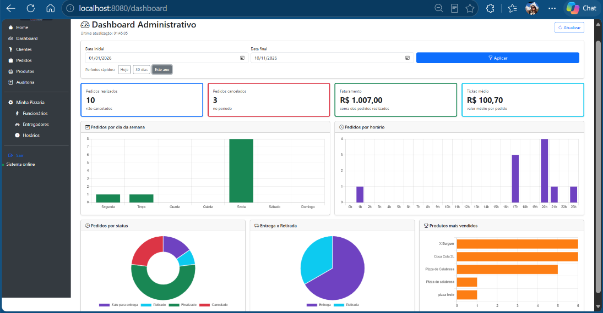

</div>

---

## 📋 2. Requisitos funcionais

| Código | Requisito | Como foi atendido | Endpoint |
|---|---|---|---|
| **RF01** | Indicadores gerais de vendas | 4 cards: pedidos realizados, pedidos cancelados, faturamento e ticket médio | `GET /api/dashboard/resumo` |
| **RF02** | Análise de vendas (gráficos) | Gráfico de pedidos por dia da semana (segunda a domingo) e gráfico de pedidos por horário (0h a 23h), que mostram os dias e horários de mais vendas | `GET /api/dashboard/vendas-por-dia-da-semana` e `GET /api/dashboard/vendas-por-hora` |
| **RF03** | Situação dos pedidos | Gráfico de rosca com a quantidade de pedidos em cada status e gráfico de pizza Entrega x Retirada | `GET /api/dashboard/pedidos-por-status` e `GET /api/dashboard/entrega-retirada` |
| **RF04** | Produtos mais vendidos | Gráfico de barras horizontais com o top 5 de produtos por quantidade vendida | `GET /api/dashboard/produtos-mais-vendidos` |
| **RF05** | Filtros de consulta | Data inicial e data final, com atalhos "Hoje", "30 dias" e "Este ano". Todos os cards e gráficos usam o mesmo período | parâmetros `dataInicio`, `dataFim` e `limite` |
| **RF06** | Integração com a API | A página chama os 6 endpoints com `fetch()`, um depois do outro, e desenha a tela com o JSON recebido | todos |
| **RF07** | Atualização e tratamento de dados | Botão "Atualizar" (busca os dados de novo na API sem recarregar a página), horário da última atualização, mensagens de erro da API na tela (período inválido, sessão expirada, perfil sem acesso) e tratamento no servidor de valores vazios, pedidos sem data e cancelados | todos |

### 🧮 Regras de cálculo

| Indicador | Regra |
|---|---|
| Período | Pedidos com `dataPedido` (entrada) entre 00:00 da data inicial e 23:59:59 da data final |
| Período padrão | Últimos 30 dias (hoje e os 29 dias anteriores), quando as datas não são informadas |
| Pedidos realizados | Todos os pedidos do período, menos os `CANCELADO` |
| Pedidos cancelados | Pedidos com status `CANCELADO` |
| Faturamento | Soma do `valorTotal` (já com desconto) dos pedidos realizados |
| Ticket médio | Faturamento ÷ pedidos realizados (zero quando não há pedidos, para não dividir por zero) |
| Pedidos por dia da semana | Pedidos realizados agrupados pelo dia da semana da entrada (`dataPedido`), de segunda a domingo |
| Pedidos por horário | Pedidos realizados agrupados pela hora de entrada (`dataPedido`), de 0h a 23h. Ex: 19:45 conta na faixa das 19h |
| Pedidos por status | Quantidade em cada um dos 7 status, mostrada no gráfico de rosca |
| Entrega x Retirada | Pedidos que saíram para entrega e pedidos retirados no balcão. Usa o campo `tipoSaida`, gravado na saída; em pedidos antigos sem esse campo, usa o status atual. Pedidos que ainda não saíram não entram |
| Produtos mais vendidos | Soma das quantidades dos itens dos pedidos realizados. O valor é quantidade × preço unitário, antes do desconto do pedido |

---

## 🔒 3. Requisitos não funcionais

| Código | Categoria | Requisito |
|---|---|---|
| **RNF01** | Segurança | Dashboard e API acessíveis só para **ADMIN** e **GERENTE**, com regra por URL no `SecurityConfig` e `@PreAuthorize` no `DashboardService`. Sem login a API responde **401**, e um perfil sem permissão recebe **403** |
| **RNF02** | Segurança | A tela não insere HTML vindo do banco: os números entram com `textContent` e os nomes de produtos são desenhados pelo Chart.js no gráfico, o que evita execução de script (XSS) |
| **RNF03** | Desempenho | O filtro de período é feito **no MongoDB** (`@Query` com `$gte` e `$lt` em `dataPedido`), e não trazendo todos os pedidos para o Java |
| **RNF04** | Desempenho | Período máximo de 366 dias e no máximo 50 produtos no ranking, para a consulta não ficar pesada |
| **RNF05** | Usabilidade | Layout responsivo com Bootstrap 5 (o mesmo do sistema); valores em reais e datas no formato brasileiro |
| **RNF06** | Confiabilidade | Filtros errados e regras recusadas devolvem `400` com a mensagem em português em `{"erro": "..."}`, que a tela mostra para o usuário |
| **RNF07** | Compatibilidade | Gráficos com o **Chart.js 2.9.4** que já estava na pasta `static/plugins` do projeto, sem nenhuma dependência nova no `pom.xml` |
| **RNF08** | Manutenibilidade | Separação em camadas: `DashboardController` (tela), `DashboardApiController` (API), `DashboardService` (regras), `PedidoRepository` (banco) e DTOs (formato da resposta) |
| **RNF09** | Testabilidade | Regras e permissões cobertas por testes automatizados que rodam sem banco de dados |

---

## 🧱 4. Arquitetura e modelo de dados

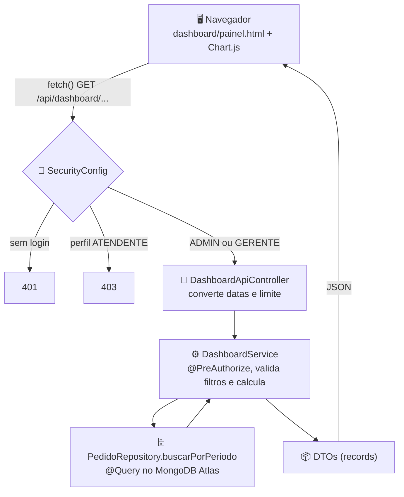

| Arquivo | Papel |
|---|---|
| `controller/DashboardController.java` | Abre a página `/dashboard` |
| `controller/DashboardApiController.java` | Endpoints `/api/dashboard/**` |
| `service/DashboardService.java` | Validação dos filtros e cálculos |
| `repository/PedidoRepository.java` | Método `buscarPorPeriodo` com `@Query` |
| `dto/*.java` | `ResumoVendasDTO`, `VendaDiaSemanaDTO`, `VendaPorHoraDTO`, `StatusQuantidadeDTO`, `EntregaRetiradaDTO`, `ProdutoVendidoDTO` |
| `entity/Pedido.java` e `service/PedidoService.java` | Campo novo `tipoSaida`, gravado quando o pedido sai para entrega ou é retirado |
| `controller/GlobalControllerAdvice.java` | Transforma erros de regra e de parâmetro em resposta 400 |
| `templates/dashboard/painel.html` | Tela, gráficos e JavaScript |

### 🗄️ 4.1 Modelo de dados usado pelo dashboard

O dashboard não cria uma coleção nova: ele lê a coleção `pedidos`, que já existia no sistema. A análise dos requisitos mostrou quais campos cada indicador precisa:

| Campo do `Pedido` | Tipo | Usado em |
|---|---|---|
| `dataPedido` | data e hora | Filtro de período, pedidos por dia da semana e por horário |
| `status` | enum `StatusPedido` | Realizados × cancelados, gráfico de status, entrega × retirada (pedidos antigos) |
| `valorTotal` | número | Faturamento e ticket médio (valor final, com desconto) |
| `itens` | lista de `ItemPedido` | Produtos mais vendidos |
| `itens[].nomeProduto` | texto | Nome do produto no ranking |
| `itens[].quantidade` | número | Quantidade vendida no ranking |
| `itens[].precoUnitario` | número | Valor vendido de cada produto |
| `tipoSaida` | enum `StatusPedido` | **Campo novo**: guarda `SAIU_PARA_ENTREGA` ou `RETIRADO` no momento da saída, para o gráfico Entrega × Retirada |

Exemplo de um pedido no MongoDB, com os campos usados:
```json
{
  "_id": "6731a9...",
  "dataPedido": "2026-11-06T20:15:00",
  "status": "FINALIZADO",
  "tipoSaida": "SAIU_PARA_ENTREGA",
  "valorTotal": 90.0,
  "itens": [
    { "nomeProduto": "Pizza Calabresa", "quantidade": 1, "precoUnitario": 50.0 },
    { "nomeProduto": "Refrigerante 2L", "quantidade": 2, "precoUnitario": 20.0 }
  ]
}
```

---

## 🔌 5. Documentação dos endpoints

### 📎 5.1 Informações comuns

| Item | Valor |
|---|---|
| URL base | `http://localhost:8080/api/dashboard` |
| Método | Todos são `GET` (só consultam, não alteram dados) |
| Formato da resposta | `application/json` |
| Autenticação | Sessão do login do sistema (cookie `JSESSIONID`). Para testar, faça login como `gerente` ou `admin` e abra a URL no navegador |
| Perfis | `ADMIN` e `GERENTE` |
| Datas | Formato ISO `AAAA-MM-DD` (ex: `2026-11-09`) |

**Parâmetros de período**, aceitos por todos os endpoints:

| Parâmetro | Tipo | Obrigatório | Padrão | Descrição |
|---|---|---|---|---|
| `dataInicio` | data `AAAA-MM-DD` | não | 29 dias antes de `dataFim` | Primeiro dia do período |
| `dataFim` | data `AAAA-MM-DD` | não | hoje | Último dia do período (incluído) |

**Erros comuns a todos os endpoints:**

| Código | Quando acontece | Corpo da resposta |
|---|---|---|
| `400` | `dataInicio` depois de `dataFim` | `{"erro": "A data inicial não pode ser depois da data final."}` |
| `400` | Período maior que 366 dias | `{"erro": "O período máximo de consulta é de 366 dias."}` |
| `400` | Data em formato errado (ex: `09/11/2026`) | `{"erro": "Valor inválido para o parâmetro 'dataInicio'. Use o formato AAAA-MM-DD (ex: 2026-11-09)."}` |
| `400` | Número em formato errado (ex: `limite=abc`) | `{"erro": "Valor inválido para o parâmetro 'limite'."}` |
| `401` | Requisição sem login | corpo vazio |
| `403` | Usuário logado com perfil ATENDENTE | corpo vazio; no navegador, abre a página de acesso negado |

---

### 🟢 5.2 `GET /api/dashboard/resumo`: indicadores gerais (RF01)

**Parâmetros:** `dataInicio`, `dataFim`

**Exemplo de requisição**
```
GET /api/dashboard/resumo?dataInicio=2026-11-01&dataFim=2026-11-09
```

**Exemplo de resposta `200 OK`**
```json
{
  "dataInicio": "2026-11-01",
  "dataFim": "2026-11-09",
  "pedidosRealizados": 11,
  "pedidosCancelados": 1,
  "faturamento": 742.5,
  "ticketMedio": 67.5
}
```

| Campo | Descrição |
|---|---|
| `dataInicio`, `dataFim` | Período usado no cálculo (mostra o padrão quando não informado) |
| `pedidosRealizados` | Pedidos não cancelados |
| `pedidosCancelados` | Pedidos com status `CANCELADO` |
| `faturamento` | Soma do valor final dos pedidos realizados (R$) |
| `ticketMedio` | Faturamento ÷ pedidos realizados (R$) |

**Erros:** os comuns (400, 401, 403).

---

### 🟢 5.3 `GET /api/dashboard/vendas-por-dia-da-semana`: dias de mais vendas (RF02)

**Parâmetros:** `dataInicio`, `dataFim`

**Exemplo de requisição**
```
GET /api/dashboard/vendas-por-dia-da-semana?dataInicio=2026-10-01&dataFim=2026-10-31
```

**Exemplo de resposta `200 OK`**
```json
[
  { "diaSemana": "Segunda", "quantidadePedidos": 5, "faturamento": 310.0 },
  { "diaSemana": "Terça", "quantidadePedidos": 4, "faturamento": 251.0 },
  { "diaSemana": "Quarta", "quantidadePedidos": 6, "faturamento": 398.5 },
  { "diaSemana": "Quinta", "quantidadePedidos": 8, "faturamento": 512.0 },
  { "diaSemana": "Sexta", "quantidadePedidos": 15, "faturamento": 980.0 },
  { "diaSemana": "Sábado", "quantidadePedidos": 20, "faturamento": 1320.0 },
  { "diaSemana": "Domingo", "quantidadePedidos": 18, "faturamento": 1150.5 }
]
```

Sempre devolve os 7 dias, de segunda a domingo, inclusive com zero. O dia vem da data de entrada do pedido. Pedidos cancelados não entram.

**Erros:** os comuns (400, 401, 403).

---

### 🟢 5.4 `GET /api/dashboard/vendas-por-hora`: horários de mais vendas (RF02)

**Parâmetros:** `dataInicio`, `dataFim`

**Exemplo de requisição**
```
GET /api/dashboard/vendas-por-hora?dataInicio=2026-11-01&dataFim=2026-11-09
```

**Exemplo de resposta `200 OK`** (resumido: a resposta real tem as 24 horas)
```json
[
  { "hora": 0, "quantidadePedidos": 0, "faturamento": 0.0 },
  { "hora": 18, "quantidadePedidos": 3, "faturamento": 201.0 },
  { "hora": 19, "quantidadePedidos": 5, "faturamento": 340.5 },
  { "hora": 20, "quantidadePedidos": 2, "faturamento": 120.0 },
  { "hora": 23, "quantidadePedidos": 0, "faturamento": 0.0 }
]
```

Sempre devolve 24 itens (hora 0 a 23), inclusive com zero. A hora vem da data de entrada do pedido. Pedidos cancelados não entram.

**Erros:** os comuns (400, 401, 403).

---

### 🟢 5.5 `GET /api/dashboard/pedidos-por-status`: situação dos pedidos (RF03)

**Parâmetros:** `dataInicio`, `dataFim`

**Exemplo de requisição**
```
GET /api/dashboard/pedidos-por-status
```

**Exemplo de resposta `200 OK`**
```json
[
  { "status": "RECEBIDO", "descricao": "Recebido", "quantidade": 1 },
  { "status": "EM_PREPARACAO", "descricao": "Em preparação", "quantidade": 2 },
  { "status": "PRONTO", "descricao": "Pronto", "quantidade": 0 },
  { "status": "SAIU_PARA_ENTREGA", "descricao": "Saiu para entrega", "quantidade": 0 },
  { "status": "RETIRADO", "descricao": "Retirado", "quantidade": 0 },
  { "status": "FINALIZADO", "descricao": "Finalizado", "quantidade": 8 },
  { "status": "CANCELADO", "descricao": "Cancelado", "quantidade": 1 }
]
```

Sempre devolve os 7 status, na ordem do fluxo do pedido, inclusive com zero.

**Erros:** os comuns (400, 401, 403).

---

### 🟢 5.6 `GET /api/dashboard/entrega-retirada`: entrega x retirada (RF03)

**Parâmetros:** `dataInicio`, `dataFim`

**Exemplo de requisição**
```
GET /api/dashboard/entrega-retirada?dataInicio=2026-11-01&dataFim=2026-11-09
```

**Exemplo de resposta `200 OK`**
```json
[
  { "tipo": "Entrega", "quantidade": 7 },
  { "tipo": "Retirada", "quantidade": 3 }
]
```

Conta os pedidos que já saíram. Pedidos em `RECEBIDO`, `EM_PREPARACAO`, `PRONTO` e `CANCELADO` não entram.

**Erros:** os comuns (400, 401, 403).

---

### 🟢 5.7 `GET /api/dashboard/produtos-mais-vendidos`: ranking (RF04)

**Parâmetros**

| Parâmetro | Tipo | Obrigatório | Padrão | Descrição |
|---|---|---|---|---|
| `dataInicio`, `dataFim` | data | não | últimos 30 dias | Período |
| `limite` | número | não | `5` | Tamanho do ranking (1 a 50) |

**Exemplo de requisição**
```
GET /api/dashboard/produtos-mais-vendidos?limite=3
```

**Exemplo de resposta `200 OK`**
```json
[
  { "produto": "Pizza Calabresa", "quantidade": 14, "faturamento": 700.0 },
  { "produto": "Refrigerante 2L", "quantidade": 9, "faturamento": 108.0 },
  { "produto": "Pizza Mussarela", "quantidade": 6, "faturamento": 270.0 }
]
```

Ordenado da maior para a menor quantidade vendida. Pedidos cancelados não entram.

**Erros:** os comuns, mais:

| Código | Quando acontece | Corpo da resposta |
|---|---|---|
| `400` | `limite` fora de 1 a 50 | `{"erro": "O limite deve ser entre 1 e 50."}` |

---

## 🧪 6. Evidências de testes

### 🤖 6.1 Testes automatizados

Os testes do dashboard rodam sem MongoDB (o repositório é simulado com Mockito), com uma lista de pedidos montada no próprio teste.

**Como executar:** no IntelliJ, botão direito em `src/test/java` → **Run 'All Tests'**, ou no terminal:
```bash
mvnw.cmd test
```

**Testes do dashboard:**

| Classe | Teste | O que comprova |
|---|---|---|
| `DashboardServiceTest` | `resumoCalculaIndicadoresIgnorandoCancelados` | RF01: pedidos realizados, cancelados, faturamento sem os cancelados e ticket médio |
| | `resumoSemPedidosDevolveZero` | RF07: período vazio devolve zero, sem erro (ticket médio sem divisão por zero) |
| | `vendasPorDiaDaSemanaTrazOsSeteDias` | RF02: pedidos agrupados de segunda a domingo, sem cancelados |
| | `vendasPorHoraAgrupaPeloHorarioDeEntrada` | RF02: pedidos agrupados pela hora, com as 24 horas |
| | `pedidosPorStatusTrazOsSeteStatus` | RF03: todos os status, inclusive com zero |
| | `entregaRetiradaContaComoOPedidoSaiu` | RF03 e RF07: conta entregas e retiradas, inclusive em pedidos antigos sem `tipoSaida` |
| | `produtosMaisVendidosSomaQuantidadesSemCancelados` | RF04: soma e ranking sem cancelados |
| | `dataInicialDepoisDaFinalERecusada` | RF05: validação do período |
| | `periodoMaiorQueUmAnoERecusado` | RNF04: limite do período |
| | `limiteForaDaFaixaERecusado` | RNF04: limite do ranking |
| | `semDatasUsaOsUltimosTrintaDias` | RF05: período padrão |
| | `pedidoSemValorOuSemDataNaoQuebraOCalculo` | RF07: tratamento de dados incompletos |
| `AutorizacaoBackendTest` | `dashboardSemLoginRecebe401` | RNF01: API sem login |
| | `atendenteNaoAcessaODashboard` | RNF01: perfil sem permissão recebe 403 |
| | `gerenteRecebeOResumoEmJson` | RF06: resposta JSON com os campos e datas no formato certo |
| | `dataEmFormatoErradoDevolve400ComMensagem` | RNF06: erro de parâmetro com mensagem clara |

O projeto tem outras classes de teste, para as regras de pedidos, auditoria e segurança: `PedidoServiceRegrasTest`, `ClienteServiceAuditoriaTest`, o restante do `AutorizacaoBackendTest` e o `PedidoServiceTest` (este último sobe a aplicação e precisa do MongoDB configurado).

> [!TIP]
> **Resultado:** 46 testes executados, **0 falhas**.

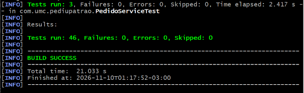

### 🙋 6.2 Testes manuais

Executados com o sistema rodando e conectado ao MongoDB Atlas. Antes dos testes, foram criados pedidos como `atendente`; como `gerente`, um pedido foi levado até "Saiu para entrega", outro até "Retirado" e um foi cancelado.

| # | Perfil | Ação | Resultado esperado | Resultado | Evidência |
|---|---|---|---|---|---|
| 1 | gerente | Abrir `/dashboard` | 4 cards e 5 gráficos carregados com os últimos 30 dias | ✅ Aprovado | `02-dashboard-gerente.png` |
| 2 | gerente | Clicar em "Este ano" | Datas mudam para 01/01 até hoje e os números são recalculados | ✅ Aprovado | `03-filtro-este-ano.png` |
| 3 | gerente | Conferir o gráfico Entrega x Retirada | Mostra os pedidos entregues e os retirados | ✅ Aprovado | `04-entrega-retirada.png` |
| 4 | gerente | Data inicial depois da final e Aplicar | Mensagem vermelha "A data inicial não pode ser depois da data final." | ✅ Aprovado | `05-erro-periodo.png` |
| 5 | gerente | Criar um pedido em outra aba e clicar em "Atualizar" | Pedidos realizados passam de 9 para 10, faturamento e horário de "Última atualização" mudam | ✅ Aprovado | `06-atualizacao.png` |
| 6 | gerente | Abrir `/api/dashboard/resumo` | JSON com os indicadores dos últimos 30 dias | ✅ Aprovado | `07-api-resumo-json.png` |
| 7 | gerente | Abrir `/api/dashboard/resumo?dataInicio=09/11/2026` | `400` com a mensagem sobre o formato AAAA-MM-DD | ✅ Aprovado | `08-api-erro-400.png` |
| 8 | atendente | Abrir `/dashboard` | Tela de acesso negado (403) | ✅ Aprovado | `09-atendente-negado.png` |
| 9 | atendente | Abrir `/api/dashboard/resumo` | Acesso negado (403); a API não devolve os dados | ✅ Aprovado | `10-api-403.png` |

**1. Dashboard aberto com os últimos 30 dias**

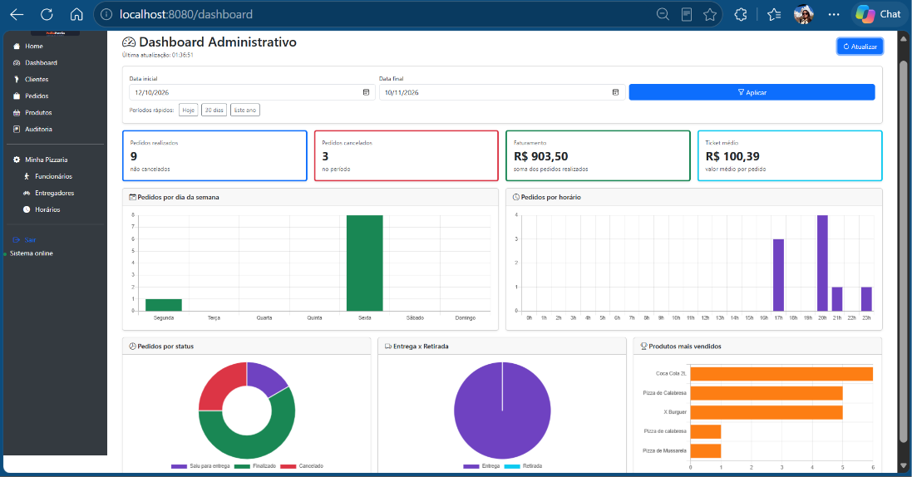

**2. Filtro "Este ano"**

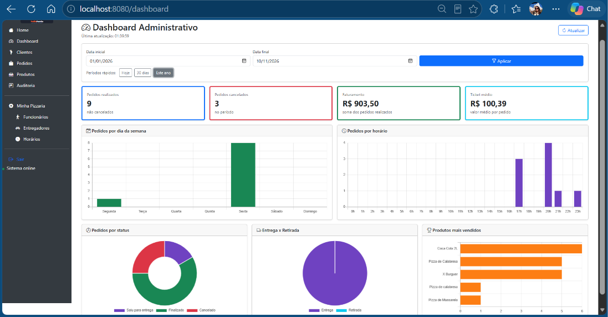

**3. Entrega x Retirada**

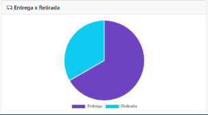

**4. Erro de período**

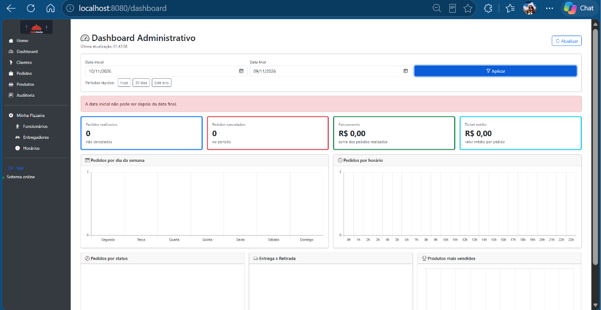

**5. Atualização após criar um pedido**


**6. API: resposta JSON do resumo**

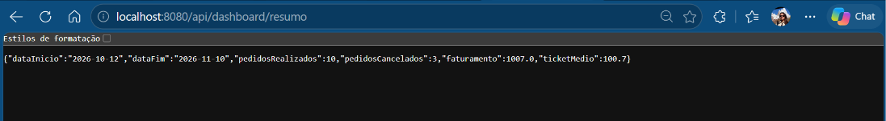

**7. API: data em formato errado (400)**

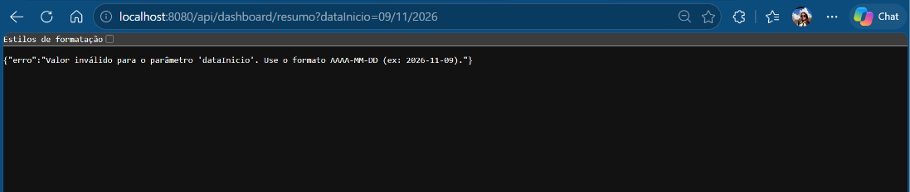

**8. Atendente tentando abrir o dashboard (403)**

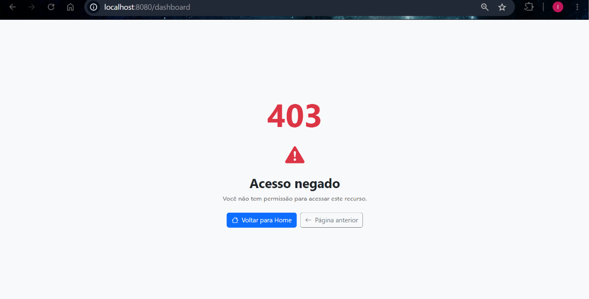

**9. Atendente tentando acessar a API (403)**

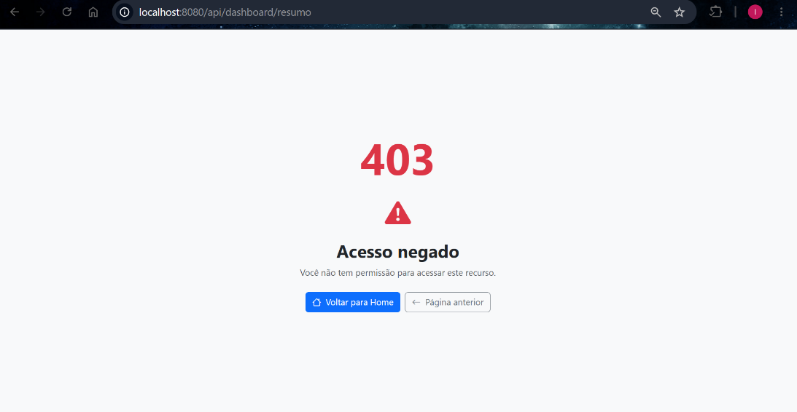

### 🔗 6.3 Rastreabilidade: requisito × teste

| Requisito | Testes automatizados | Testes manuais (seção 6.2) |
|---|---|---|
| RF01: Indicadores | `resumoCalculaIndicadoresIgnorandoCancelados`, `resumoSemPedidosDevolveZero`, `gerenteRecebeOResumoEmJson` | 1, 5, 6 |
| RF02: Gráficos de vendas | `vendasPorDiaDaSemanaTrazOsSeteDias`, `vendasPorHoraAgrupaPeloHorarioDeEntrada` | 1 |
| RF03: Situação dos pedidos | `pedidosPorStatusTrazOsSeteStatus`, `entregaRetiradaContaComoOPedidoSaiu` | 1, 3 |
| RF04: Produtos mais vendidos | `produtosMaisVendidosSomaQuantidadesSemCancelados`, `limiteForaDaFaixaERecusado` | 1 |
| RF05: Filtros | `dataInicialDepoisDaFinalERecusada`, `periodoMaiorQueUmAnoERecusado`, `semDatasUsaOsUltimosTrintaDias` | 2, 4 |
| RF06: Integração com a API | `gerenteRecebeOResumoEmJson`, `dataEmFormatoErradoDevolve400ComMensagem` | 6, 7 |
| RF07: Atualização e tratamento | `pedidoSemValorOuSemDataNaoQuebraOCalculo`, `resumoSemPedidosDevolveZero` | 4, 5 |
| RNF01: Segurança | `dashboardSemLoginRecebe401`, `atendenteNaoAcessaODashboard` | 8, 9 |

---

## 🧠 7. Decisões de análise e projeto

| Decisão | Justificativa |
|---|---|
| **API separada da tela** (`DashboardApiController` × `DashboardController`) | A atividade pede um painel que consome uma API. Separar permite que outro sistema (um app, por exemplo) use os mesmos endpoints |
| **Um endpoint por bloco da tela** | Cada endpoint tem uma responsabilidade (resumo, dia da semana, horário, status, entrega x retirada e ranking), fica mais fácil de documentar e testar, e a tela pode atualizar cada bloco separado no futuro |
| **Cálculos no servidor** (`DashboardService`) | Mantém as regras em um só lugar e no mesmo padrão do resto do projeto (regras no service). A tela só exibe |
| **Filtro de período no MongoDB** (`@Query`) | Evita trazer todos os pedidos do banco a cada consulta. Usei `@Query` porque o nome derivado repetiria o campo `dataPedido` duas vezes, e o MongoDB não monta essa consulta |
| **DTOs com `record`** | A resposta tem só o que o painel precisa (sem expor a entidade inteira), e o `record` deixa a classe curta |
| **Cancelados fora do faturamento, do ticket médio, dos gráficos de vendas e do ranking** | Pedido cancelado não é venda. Ele aparece separado, no card de cancelados e no gráfico de status |
| **Faturamento com valor final (com desconto)** | É o valor que de fato entra no caixa |
| **Só cards e gráficos, sem tabelas** | Os 4 cards mostram os números principais de relance. Dias e horários de pico, comparação de status, entrega x retirada e ranking de produtos ficam mais fáceis de ler em gráfico do que em tabela |
| **Ticket médio** | Mostra quanto cada pedido vale em média; ajuda a avaliar promoções e combos |
| **Gráfico por horário** | Mostra os horários de pico, útil para planejar equipe e preparo |
| **Dia da semana e horário, em vez de dia a dia** | Para a pizzaria, saber que sexta e sábado à noite concentram os pedidos ajuda mais a planejar equipe e estoque do que ver a lista de datas |
| **Campo `tipoSaida` no pedido** | Depois da saída, o status vira `FINALIZADO` e não daria mais para saber se foi entrega ou retirada. Pedidos antigos, sem o campo, usam o status atual |
| **Quantidade de cancelados, e não taxa** | O card mostra quantos pedidos foram cancelados no período, que é o número que o gerente confere com os cancelamentos registrados na auditoria |
| **Período padrão de 30 dias e máximo de 366** | 30 dias é uma visão útil de tendência. O máximo protege o desempenho da consulta |
| **Acesso ADMIN e GERENTE** | São os responsáveis pelo estabelecimento. O ATENDENTE opera os pedidos, mas não precisa dos números de faturamento |
| **Chart.js do próprio projeto** | Já estava em `static/plugins` (veio do AdminLTE do projeto base), então não foi preciso adicionar dependência |
| **Erros com mensagem em JSON** | Quem consome a API recebe o motivo do erro, e a tela mostra essa mensagem para o usuário |

---

## 🌿 8. Gitflow

| Branch | Conteúdo |
|---|---|
| `main` | Versão estável do sistema |
| `develop` | Integração das funcionalidades antes de irem para a `main` |
| `feature/correcoes-parte1` | Regras de pedidos, auditoria, gestão de usuários e segurança (base para o dashboard) |
| `feature/dashboard-api` | API do dashboard, tela do dashboard, testes e documentação |

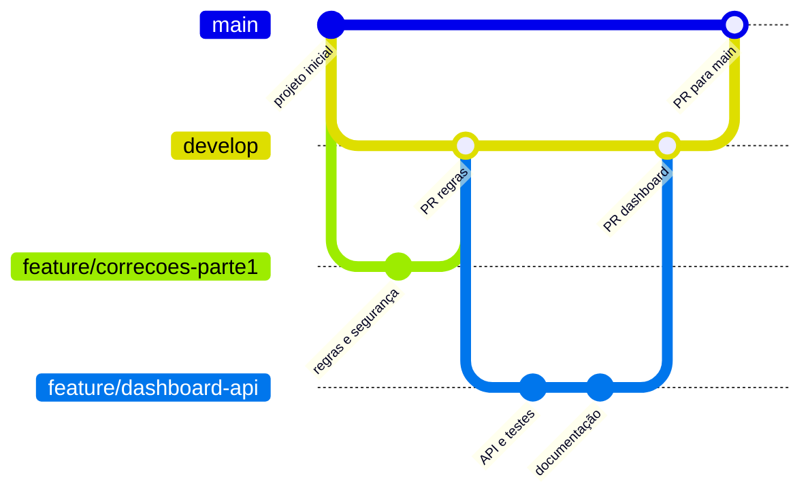

A `feature/dashboard-api` foi criada a partir da `develop` já com as regras de pedidos e segurança. As branches são mantidas depois do merge, como registro do desenvolvimento.
